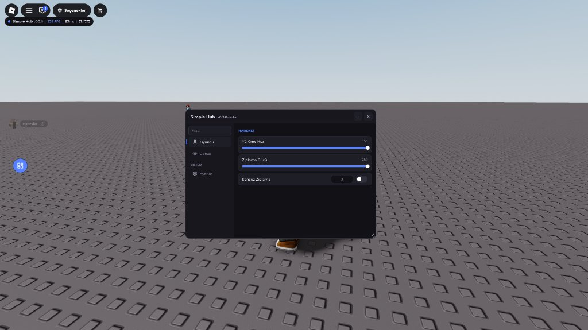

<div align="center">

# 🪐 Orbit UI

**Roblox Executor Scriptleri İçin Modern, Modüler ve Yüksek Performanslı Arayüz Kütüphanesi**

[](https://github.com/Comesfar/orbit-ui/releases)
[](https://luau-lang.org/)
[](https://github.com/Comesfar/orbit-ui)

*WindUI ve Fluent tasarım dilinden ilham alan; canlı tema geçişi, 9-slice yumuşak gölge, dahili ikon motoru, otomatik kayıt, Key System, Watermark ve Keybind HUD destekli tek satırlık UI kütüphanesi.*

<br/>



</div>

---

## 📌 İçindekiler

- [✨ Öne Çıkan Özellikler](#-öne-çıkan-özellikler)
- [🧩 Bileşen Tablosu](#-bileşen-tablosu)
- [🚀 Hızlı Başlangıç](#-hızlı-başlangıç)
- [🧪 Kapsamlı Test Scripti (v0.3.1-beta)](#-kapsamlı-test-scripti-v031-beta)
- [📖 API Referansı](#-api-referansı)
- [🗂️ Mimari & Geliştirme](#️-mimari--geliştirme)

---

## ✨ Öne Çıkan Özellikler

- 🎨 **Canlı Tema & Özel Renk Motoru:** Oyun içinden anında tema (`Dark`, `Midnight`, `Rose`, `Light`) ve vurgu rengi (`Accent`) değiştirme veya `Orbit:CreateTheme("TemaAdi", {...})` ile kendi özel temanı kaydetme.
- 🌑 **9-Slice Yumuşak Gölge (`DropShadow`) & Dalga Efekti (`Ripple`):** Pencere etrafında derinlik hissi veren yumuşak gölge ve tüm butonlarda tıklanan noktadan yayılan modern dalga animasyonu.
- ⚡ **Sıfır Gecikmeli İkon Motoru:** En sık kullanılan 30+ Lucide ikonu doğrudan kütüphaneye gömülüdür (anında yüklenir); 1500+ ek Lucide ikonu ise menüyü bekletmeden arka planda asenkron çekilir.
- 🔢 **Doğrudan Sayı Girişli Slider & Aramalı Dropdown:** Slider değerinin üstüne tıklayarak klavyeyle doğrudan sayı girebilme, çok seçenekli Dropdown menülerde anlık arama kutusu ve dışarı tıklayınca otomatik kapanma.
- 📱 **Mobil & Masaüstü Uyumlu:** Dokunmatik cihazlar için sürüklenebilir yuvarlak aç/kapat butonu, küçük ekranlara otomatik ölçekleme (`UIScale`) ve sağ alt köşeden boyutlandırma.
- 🔍 **Anlık Global Arama:** Sol üstteki arama kutusu tüm sekmelerdeki ve katlanabilir kartlardaki bileşenleri anında filtreler, temizle (`×`) butonuyla tek tıkla sıfırlanır.
- 🛡️ **Executor Güvenliği & Hata Koruması:** `cloneref` servis koruması, `gethui` / `CoreGui` / `PlayerGui` otomatik seçimi ve menüyü çökertmeyen `pcall` sarmallı callback sistemi.
- 💾 **Otomatik Config Sistemi:** `Flag` verilen tüm bileşenleri JSON olarak kaydeder, yükler ve `EnableAutoSave` ile her değişiklikte otomatik günceller.
- 🔔 **4 Köşeli Akıllı Bildirim Sistemi:** Bildirimler koddan (`Orbit:SetNotificationPosition("TopRight")`) veya oyun içi Ayarlar sekmesindeki açılır menüden 4 farklı köşeye (`BottomRight`, `TopRight`, `BottomLeft`, `TopLeft`) taşınabilir.
- 🧰 **Hazır Hub Araçları:** Dahili **Key System** (anahtar doğrulama + kaydetme), **Watermark** (FPS, Ping, Saat) ve **Keybinds HUD** (aktif tuş takip paneli).

---

## 🧩 Bileşen Tablosu

| Bileşen | Metod | Açıklama | `Flag` / Config Desteği |
| :--- | :--- | :--- | :---: |
| **Pencere** | `Orbit:CreateWindow(cfg)` | Ana pencere, gölge, arama ve sekme yöneticisi | — |
| **Özel Tema** | `Orbit:CreateTheme(ad, palet)` | Yeni tema ekler (Ayarlar sekmesine otomatik düşer) | — |
| **Watermark** | `Orbit:AddWatermark(cfg)` | Sürüklenebilir canlı FPS, Ping ve Saat rozeti | — |
| **Key System** | `Orbit:CreateKeySystem(cfg)` | Anahtar doğrulama ve `saved_key.txt` kayıt ekranı | — |
| **Keybinds HUD** | `Window:CreateKeybindList(cfg)` | Atanmış tuşları ve `[ON]/[OFF]` durumunu gösteren HUD | — |
| **Bildirim** | `Orbit:Notify(cfg)` | `Info`, `Success`, `Warning`, `Error` tipli, sesli & butonlu bildirim | — |
| **Onay Kutusu** | `Window:Dialog(cfg)` | Karartmalı onay / uyarı penceresi | — |
| **Bölüm / Kart** | `Tab:Section(cfg)` | Düz başlık veya `Collapsible = true` ile katlanabilir kart | — |
| **Buton** | `Tab:Button(cfg)` | Ripple dalga efektli, ikonlu ve açıklamalı buton | — |
| **Toggle** | `Tab:Toggle(cfg)` | Aç/Kapat anahtarı + isteğe bağlı yan `Keybind` kısayolu | ✅ |
| **Slider** | `Tab:Slider(cfg)` | Sürüklenebilir + üstüne tıklayıp klavyeyle değer girilebilir bar | ✅ |
| **RangeSlider** | `Tab:RangeSlider(cfg)` | Alt ve üst limit seçimi için çift tutamaçlı slider | ✅ |
| **ProgressBar** | `Tab:ProgressBar(cfg)` | Salt-okunur canlı ilerleme/durum çubuğu | ✅ |
| **Dropdown** | `Tab:Dropdown(cfg)` | Tekli/Çoklu seçim, içeriden arama (`Searchable`) ve dışarı tıklama | ✅ |
| **Input / TextArea** | `Tab:Input(cfg)` / `TextArea` | Tek satırlı veya çok satırlı metin girdi alanı | ✅ |
| **Keybind** | `Tab:Keybind(cfg)` | Klavye kısayol atayıcı (`RightShift` veya `Backspace` ile sıfırlanır) | ✅ |
| **ColorPicker** | `Tab:ColorPicker(cfg)` | HSV renk tekeri + canlı önizleme | ✅ |

---

## 🚀 Hızlı Başlangıç

Executor'ına yapıştırıp hemen çalıştırabilirsin:

```lua
local Orbit = loadstring(game:HttpGet("https://raw.githubusercontent.com/Comesfar/orbit-ui/main/dist/Orbit.lua"))()

local Window = Orbit:CreateWindow({
    Title = "Simple Hub",
    Subtitle = "v0.3.1-beta",
    Theme = "Midnight",                  -- Dark | Midnight | Rose | Light
    ToggleKey = Enum.KeyCode.RightShift, -- Menüyü aç/kapat tuşu
    Blur = false,                        -- Arka plan bulanıklığı
    ConfigFolder = "SimpleHub",          -- Config kayıt klasörü
})

-- Sol üstte canlı FPS / Ping / Saat göstergesi
Orbit:AddWatermark({
    Title = "Simple Hub",
    Build = "v0.3.1",
    ShowFPS = true,
    ShowPing = true,
    ShowTime = true,
})

local Oyuncu = Window:Tab({ Title = "Oyuncu", Icon = "user" })

Oyuncu:Section("Hareket")

Oyuncu:Slider({
    Title = "Yürüme Hızı",
    Flag = "walkspeed",
    Min = 16, Max = 150, Default = 16,
    Callback = function(v)
        local hum = game.Players.LocalPlayer.Character and game.Players.LocalPlayer.Character:FindFirstChildOfClass("Humanoid")
        if hum then hum.WalkSpeed = v end
    end,
})

Oyuncu:Toggle({
    Title = "Sonsuz Zıplama",
    Flag = "infjump",
    Keybind = Enum.KeyCode.J,
    Default = false,
    Callback = function(state)
        print("Sonsuz Zıplama:", state)
    end,
})

Window:TabSection("Sistem")
Window:AddSettingsTab()
```

---

## 🧪 Kapsamlı Test Scripti (`v0.3.1-beta`)

Deponun kök dizinindeki [`example.lua`](example.lua) dosyası; **Özel Tema (`Cyberpunk`)**, **Katlanabilir Kartlar**, **Klavyeyle Sayı Girilen Slider**, **Aramalı & Çoklu Dropdown**, **Keybinds HUD**, **ProgressBar**, **Ripple Butonlar** ve **Zengin Bildirimler** dahil tüm yeni özellikleri tek seferde denemen için hazırlanmıştır:

```lua
loadstring(game:HttpGet("https://raw.githubusercontent.com/Comesfar/orbit-ui/main/example.lua"))()
```

---

## 📖 API Referansı

### 1. Pencere, Sekmeler & Özel Tema (`Window` & `Tab`)
```lua
-- Kendi özel temanı kaydet (Ayarlar sekmesindeki Tema listesine otomatik eklenir)
Orbit:CreateTheme("Cyberpunk", {
    Background   = Color3.fromRGB(13, 10, 22),
    Sidebar      = Color3.fromRGB(18, 14, 30),
    Element      = Color3.fromRGB(26, 20, 44),
    ElementHover = Color3.fromRGB(36, 28, 60),
    Stroke       = Color3.fromRGB(58, 44, 94),
    Text         = Color3.fromRGB(240, 240, 255),
    SubText      = Color3.fromRGB(155, 145, 195),
    Accent       = Color3.fromRGB(0, 240, 195),
    Danger       = Color3.fromRGB(255, 75, 105),
})

Window:TabSection("Kategori Başlığı")
local Tab = Window:Tab({ Title = "Sekme Adı", Icon = "house" })

-- Canlı tema ve renk değiştirme
Window:SetTheme("Cyberpunk")
Window:SetAccent(Color3.fromRGB(0, 220, 180))
Window:ResetAccent()

-- Otomatik kayıt (tüm sekmeler oluşturulduktan sonra çağrılır)
Window:EnableAutoSave("default")
```

### 2. Katlanabilir Kart / Bölüm (`Section`)
Hem düz başlık hem de içine bileşen eklenebilen akordiyon kart olarak kullanılabilir:
```lua
-- Düz başlık
Tab:Section("Genel Ayarlar")

-- Katlanabilir (Collapsible) Kart
local Card = Tab:Section({
    Title = "Otomatik Farm",
    Icon = "swords",
    Collapsible = true,
    Default = true, -- Açık başlasın
})
Card:Toggle({ Title = "Oto Sandık", Flag = "auto_chest", Callback = print })
Card:Slider({ Title = "Menzil", Min = 10, Max = 100, Default = 40, Suffix = "m" })
```

### 3. Slider, RangeSlider & ProgressBar
```lua
-- Slider (Sağ üstteki sayıya tıklayıp klavyeyle doğrudan değer yazabilirsin!)
local Sld = Tab:Slider({
    Title = "Hız",
    Flag = "speed",
    Min = 0, Max = 200, Step = 0.5, Default = 16,
    Suffix = " stud/s",
    Callback = function(val) end,
})

-- İkili Aralık Slider (RangeSlider)
Tab:RangeSlider({
    Title = "Mesafe Aralığı",
    Flag = "dist_range",
    Min = 0, Max = 100, Default = { 20, 80 },
    Callback = function(minVal, maxVal) end,
})

-- İlerleme Çubuğu (ProgressBar)
local Bar = Tab:ProgressBar({
    Title = "Görev İlerlemesi",
    Min = 0, Max = 100, Default = 35, Suffix = "%",
})
Bar:Set(80)
```

### 4. Aramalı & Çoklu Seçim Dropdown
```lua
local Dp = Tab:Dropdown({
    Title = "Silah Seç",
    Flag = "weapon_select",
    Values = { "AK-47", "M4A1", "AWP", "Deagle", "MP5", "Shotgun", "Katana", "RPG", "Laser Gun" },
    Multi = false,       -- true yapılırsa çoklu seçim
    Searchable = true,   -- İçinde filtreleme kutusu açar (>8 elemanda otomatik açılır)
    Default = "AK-47",
    Callback = function(selected) end,
})
Dp:Refresh({ "Yeni 1", "Yeni 2" })
```

### 5. Zengin Bildirimler & Onay Penceresi (`Notify` & `Dialog`)
```lua
-- Bildirimlerin çıkacağı köşeyi ayarla (BottomRight | TopRight | BottomLeft | TopLeft)
Orbit:SetNotificationPosition("TopRight")

Orbit:Notify({
    Title = "İşlem Tamamlandı",
    Content = "Ayarlar başarıyla uygulandı.",
    Type = "Success", -- Info | Success | Warning | Error
    Duration = 5,
    Sound = true,
    Buttons = {
        { Title = "Harika", Primary = true, Callback = function() end },
    },
})

Window:Dialog({
    Title = "Emin misin?",
    Content = "Bu işlem geri alınamaz.",
    Buttons = {
        { Title = "İptal" },
        { Title = "Evet, Sıfırla", Danger = true, Callback = function() end },
    },
})
```

---

## 🗂️ Mimari & Geliştirme

```
orbit-ui/
├── assets/preview.jpg  # Oyun içi ekran görüntüsü
├── loader.lua          # Modülleri src/ altından dinamik yükler (yerel veya HttpGet)
├── build.ps1           # src/ altındaki tüm modülleri dist/Orbit.lua olarak tek dosyada birleştirir
├── example.lua         # Tüm v0.3.1-beta özelliklerini içeren kapsamlı test scripti
├── dist/Orbit.lua      # Tek dosyalık dağıtım paketi (UTF-8 BOM'suz)
└── src/
    ├── init.lua        # Giriş noktası (Orbit tablosu, CreateTheme, CreateWindow)
    ├── Util.lua        # New, Tween, Drag, MakeDraggable, Ripple, cloneref Service
    ├── Themes.lua      # Dark, Midnight, Rose, Light temaları
    ├── Icons.lua       # 30+ dahili Lucide ikon + arka plan yükleyici
    ├── Window.lua      # Pencere, DropShadow, Arama, Boyutlandırma, Canlı Tema
    ├── Tab.lua         # Sekme yönetimi ve element bağlamı
    ├── Notify.lua      # Tipli, ikonlu, sesli ve butonlu bildirimler
    ├── Dialog.lua      # Onay pencereleri
    ├── Watermark.lua   # Canlı FPS / Ping / Saat göstergesi
    ├── KeybindList.lua # Canlı tuş takip HUD paneli
    ├── KeySystem.lua   # Lisans / anahtar doğrulama ekranı
    ├── SettingsTab.lua # Hazır ayarlar sekmesi
    ├── Config.lua      # JSON kayıt / yükleme ve AutoSave
    ├── Tooltip.lua     # Fare ipucu sistemi
    └── Elements/       # Tüm UI bileşenleri
```

Değişiklik yaptıktan sonra tek dosya paketini güncellemek için PowerShell'de `./build.ps1` çalıştırman yeterlidir.
